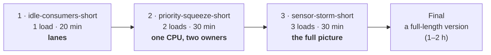

# Load Scenario Kit — D0020E

One machine, three kinds of real work fighting over it: **batch jobs**, a **data stream** and **user traffic**.
The kit runs a scripted, repeatable "storm" on that machine, measures everything every 15 seconds, and writes a
**diary** of every real event *with its cause*. Your job in the course is to add the intelligence on top:
a **scaler**, a **forecaster**, an **early-warning detector** and a **cause-finder**.

**Read in this order:**

1. [`students/PROJECT.md`](students/PROJECT.md): the big picture, why it matters, the hardware.
2. [`students/SCENARIOS.md`](students/SCENARIOS.md): your three scenarios, step by step.
3. [`students/TASK.md`](students/TASK.md): what you build, how it plugs in, how it is graded.

---

## Get started (about 15 minutes)

You need **Python 3.10+** (3.12 recommended, as in the pipeline) and **Git**. No Kubernetes, no Docker: day to day,
the kit runs on its built-in **simulated node**.

```bash
# 1. your group's repository
git clone <your group's repository URL>
cd <repository folder>

# 2. a virtual environment and the packages
python -m venv .venv
source .venv/bin/activate            # Windows PowerShell: .venv\Scripts\Activate.ps1
pip install pyyaml kubernetes redis openpyxl ruff coverage

# 3. check that everything works: the same checks as the pipeline
make ci-local                        # without make: see "Commands" below
```

`make ci-local` should end with every short scenario `ok`. If it doesn't, ask before you change anything.

### Your first run

```bash
python -m loadkit run idle-consumers-short --runner fake
```

It finishes in a few seconds and prints the run folder, e.g. `runs/idle-consumers-short-s42-fake-…/`.
Open its **`README.txt`**: it says what ran, what happened, and when a load was unhealthy and why.

### The UI

```bash
make ui                              # or: python -m loadkit serve
```

Open **http://127.0.0.1:8765**. Choose a scenario and press **Start**. Without a cluster, it runs on the simulated
node. Use **Open a past run** to see any finished run, and drag the slider to replay it. The **Advanced** panels show
the timeline, the diary, replicas and scaler decisions, and the **Forecast** panel.

---

## The scenario flow

You work through **three scenarios, in this order**. Each adds **exactly one new idea**:



| Step | Scenario | Loads | The one new idea | Look for |
|---|---|---|---|---|
| 1 | `idle-consumers-short` | stream | **Lanes**: events are spread over 2 partitions; more consumers than partitions add no speed | replicas above 2, `consumers_idle` in the diary, the backlog does not drop faster |
| 2 | `priority-squeeze-short` | stream (high) + batch (low) | **One CPU, two owners**: when the machine is full, priority decides who yields | `consumers_scaled`, then `pod_preempted` on the ETL pods; the ETL loses its progress and takes much longer |
| 3 | `sensor-storm-short` | stream + users + batch | **The full picture**: one load slows another indirectly | replicas jump at each burst; the shop slows down although its own traffic did not change |

How to work through them:

- **Develop on the short versions** (20–30 min of scenario time, written for a 4-core machine). Prove your final
  result on the **full-length** version of one of them (`idle-consumers`, `priority-squeeze`, `sensor-storm`).
- **The seed:** steps 1 and 2 are fixed scripts, so every run is the same run. Step 3 is the first where the seed
  matters (it decides when the random bursts come). In class, use **seed 42**, so every group sees the same day.
- **Read the "look for" list before a run and check it after.** It is the scenario's answer key.
- **When a load goes red, go to the diary** (the Diary panel, or `runs/<run>/diary.jsonl`). It records every real
  event with its cause.

All details, stories and numbers: [`students/SCENARIOS.md`](students/SCENARIOS.md).
(More scenario files live in `scenarios/advanced/`. They are not part of your experiment.)

---

## Your working loop

```
branch  →  write your plugin + a test  →  make ci-local  →  push  →  pull request
        →  CI: check, test, simulate (a comment compares your change with main)  →  review  →  merge
```

- `main` is protected: you never push to it directly.
- **The core is frozen.** Your scaler, forecaster and detectors are **plugins**. They need zero changes to the engine,
  the runner, the worker or the pipeline. Changes there need the teacher's approval (`.github/CODEOWNERS`).
- The worked example of a plugin, with every line explained: `loadkit/plugins/scalers/step.py`.
- Every plugin needs a test that runs **without a cluster** (example: `tests/test_step_scaler.py`).

What the pipeline runs, and how to read its results: [`docs/CI.md`](docs/CI.md).

---

## What a run produces

Every run writes a folder `runs/<run-id>/`. This is the ground truth you are judged against.

| File | What it is |
|---|---|
| `README.txt` | the run in plain words: what ran, what happened, unhealthy periods and likely causes |
| `diary.jsonl` | every event, `planned` (from the timeline), `reactive` (with a `cause`) or `control` |
| `metrics.csv` | every metric of every load and of the machine, every 15 s |
| `health.csv` | every health check: value, limit, healthy or not |
| `impact.json` | the kit's own likely causes (your cause-finder is compared with it) |
| `timeline.json`, `scenario.yaml`, `run.json`, `calibration.json` | the plan, the settings and the machine |

Times are `t` = seconds since the scenario started (negative during warm-up and baseline).
In the UI, **Export to Excel** (next to the replay slider) gives the whole run as a workbook.

---

## Running on a real cluster (later)

| Where | When | How |
|---|---|---|
| **Simulated node** | every day | nothing to set up; `--runner fake` on the command line, the default in the UI without a cluster |
| **kind** on your laptop (optional) | if you want to see real pods | needs Docker and [kind](https://kind.sigs.k8s.io/): `make kind-up` once, then `make ui` |
| **The shared class cluster** | finals | the teacher gives your group a kubeconfig and a node: `make ui KUBECONFIG=path/to/your-kubeconfig` |

Real runs take real time: a 30-minute scenario takes about 40 minutes with warm-up and drain.
Your kubeconfig is only read, never stored. Never commit it (the pipeline refuses it).

---

## Commands

```bash
python -m loadkit list                                    # the scenarios you can run
python -m loadkit run sensor-storm-short --seed 42 --runner fake   # a run on the simulated node
python -m loadkit run sensor-storm-short --seed 42 --runner fake --without report   # the same, one load removed
python -m loadkit timeline sensor-storm-short --seed 42   # the planned events (no run)
python -m loadkit analyze runs/<run>                      # likely causes of a finished run
python -m loadkit compare runs/<run-a> runs/<run-b>       # two runs side by side
python -m loadkit snapshot runs/<run>                     # one HTML page of a run, to share
python -m loadkit validate                                # check all scenario files
python -m loadkit serve                                   # the UI (same as make ui)

make test                                                 # unit tests (no cluster needed)
make ci-local                                             # all pipeline checks
make help                                                 # all make commands
```

Without `make` (e.g. on Windows), run the lines of the `ci-local` target in the `Makefile` one by one.

---

## Repository map

```
students/        your briefs: PROJECT.md, SCENARIOS.md, TASK.md
scenarios/       the three scenarios (short + full); advanced/ = not part of your experiment
loadkit/         the kit (frozen core); loadkit/plugins/ = where your plugins go
  plugins/scalers/       target-tracking, concurrency, none, step (the worked example)
  plugins/forecasters/   reference (baseline) and timestral (the seam you complete)
ui/              the browser UI; ui/panels/ = one file per panel
worker/          the code that runs inside the pods (frozen)
tests/           unit tests, all without a cluster
ci/              the pipeline's scripts (policy, simulation)
docs/CI.md       the pipeline, explained
loadkit.yaml     settings and the list of enabled plugins (frozen)
```

## Safety

The kit only creates objects labelled `app.kubernetes.io/part-of=loadkit`, every pod has a memory limit, and
`python -m loadkit reset` removes everything it made. `runs/`, kubeconfigs and env files are git-ignored. The UI only
listens on your own computer (127.0.0.1).
